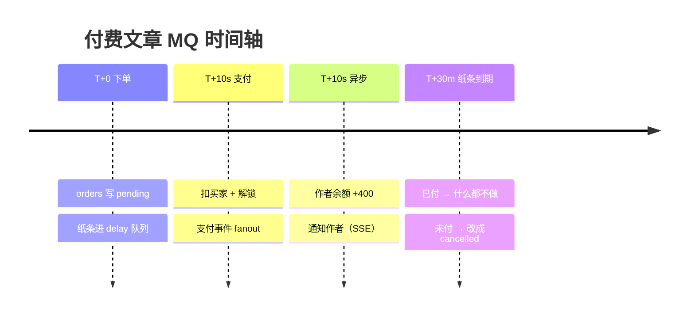

# MQ 面试要点（付费文章）

## 一句话

> **下单时发一张"30 分钟闹钟"；支付时另发一条"支付成功事件"；消费者在后台把这两类消息变成数据库操作。**
> MQ 是"后端 → 后端"的异步通道。

---

## 1. 四个队列、两个交换机

| 队列 | 谁放 | 谁取 | 干什么 |
|---|---|---|---|
| `order.delay.queue` | 下单接口 | **没人取** | 当闹钟：躺 30 分钟后过期 |
| `order.expire.queue` | Broker 把过期消息转进来 | 关单消费者 | 还是 pending → cancelled |
| `earning.queue` | 支付接口（fanout 复制） | 收益消费者 | 作者 +80% |
| `notify.queue` | 支付接口（fanout 复制） | 通知消费者 | 通知作者 |

| 交换机 | 类型 | 作用 |
|---|---|---|
| `order.exchange` | direct | 只接死信：delay → expire |
| `payment.exchange` | fanout | 复制两份：earning + notify |

---

## 2. 用户操作时间轴

```text
T+0      用户点"购买"  POST /orders
         ├─ orders 写一行：status=pending，amount=价格快照
         └─ 纸条 {"order_id":3} → order.delay.queue（TTL 30 分钟）

T+10s    用户点"我付好了"  POST /orders/3/pay
         ├─ 同步：锁订单/用户 → 查余额 → 扣买家 → orders=paid
         │        → purchases 写一行（解锁）→ commit
         └─ 异步：支付事件 → payment.exchange
                  ├─ earning.queue → 作者余额 +400、earnings 写一行
                  └─ notify.queue  → notifications 写一行 → SSE 推给作者

T+30m    纸条过期
         ├─ 订单已付   → 转进 expire 队列 → 消费者查到 paid → 什么都不做
         └─ 订单没付   → 转进 expire 队列 → 消费者改成 cancelled

异常     消费者挂了 / 后端重启
         └─ 纸条还在队列（durable + 持久化），重连后补处理
```

**关键：支付时发的是【另一条消息】，不是把 delay 里那张搬过去。**

---

### 2.1 时间轴图（录视频照这个讲）



预览不显示 mermaid 的话，用下面这张：

```text
时间 ──────────────────────────────────────────────────────────────▶

T+0                     T+10s                          T+30m
用户点「购买」           用户点「我付好了」               一直没付 / 已经付了
     │                       │                              │
     ▼                       ▼                              ▼
┌─────────────┐      ┌─────────────────┐          ┌──────────────────┐
│ 下单 API     │      │ 支付 API         │          │ 纸条在 delay 过期 │
│ 写 pending   │      │ 锁订单 / 锁用户   │          │ 死信 → expire 队列│
│ 发纸条       │      │ 扣买家 + 解锁     │          │ 消费者查订单      │
└──────┬──────┘      │ commit           │          │  paid    → 不动   │
       │             │ 发支付事件        │          │  pending → 取消   │
       ▼             └────────┬─────────┘          └──────────────────┘
 order.delay.queue            │ fanout
 （躺 30 分钟）                ▼
                    ┌─────────┴─────────┐
                    ▼                   ▼
             earning.queue        notify.queue
             作者 +400             通知作者 → SSE
```

**看图的三个要点：**

1. **下单和支付是两条独立的消息**，不是把 delay 里的纸条搬过去
2. **支付时的同步部分（扣钱、解锁）在 API 里做完才返回**，MQ 只管后面两件事
3. **30 分钟那条只管"没付的"**，付过的查一眼就跳过

---

## 3. 线程 / 进程图

```text
                        ┌─────────────────────────────┐
                        │        浏览器                │
                        └──────────────┬──────────────┘
                                       │ HTTP
                                       ▼
┌──────────────────────────────────────────────────────────────┐
│                    python 后端进程                            │
│                                                              │
│  ┌──────────────────────────┐                                │
│  │ 线程池（约 40 条）        │  ← 同步接口：登录、下单、支付   │
│  │ create_order / pay_order  │                                │
│  └────────────┬─────────────┘                                │
│               │ publish                                      │
│               ▼                                              │
│  ┌──────────────────────────┐    ┌─────────────────────────┐  │
│  │ MQ 消费者线程 × 3         │    │ loop 线程 × 1           │  │
│  │ order-expire             │    │ SSE / WebSocket         │  │
│  │ payment-earning          │    │ 通知推给浏览器           │  │
│  │ payment-notify           │    └─────────────────────────┘  │
│  └────────────┬─────────────┘                                │
└───────────────┼──────────────────────────────────────────────┘
                │ AMQP
                ▼
┌──────────────────────────────┐     ┌────────────────────────┐
│ RabbitMQ 进程（WSL）          │     │ MySQL 进程              │
│ 4 个队列 + 2 个交换机          │     │ 订单 / 购买 / 收益 / 通知│
└──────────────────────────────┘     └────────────────────────┘
```

---

## 4. 调用链（按文件）

| 时刻 | 入口 | 调了谁 | 在哪条线程 |
|---|---|---|---|
| 启动 | `main.py` lifespan | `consumers.start_consumers()` → 三次 `mq.start_consumer()` | 主线程 |
| 下单 | `orders.create_order` | `mq.publish_order_delay` → `_publish` | 线程池 |
| 30 分钟后 | Broker 转发 | `mq.on_message` → `consumers.handle_order_expire` | 消费者线程 |
| 支付 | `orders.pay_order` | `mq.publish_payment_success` → `_publish` | 线程池 |
| 支付后 | Broker 分发 | `handle_payment_earning` / `handle_payment_notify` | 消费者线程 |
| 通知里 | `handle_payment_notify` | `notifications.notify` → `sse.push_notification` | 消费者线程 |

---

## 5. 面试要点

**① 为什么用延迟队列关单？**

- 不用写定时任务扫表
- 消息在 Broker 里，服务重启不丢
- 到点自动转出来，由消费者处理

**② 同步 vs 异步**

| 动作 | 方式 | 原因 |
|---|---|---|
| 扣买家钱、写购买记录 | **同步** | 用户马上要看文章 |
| 作者收益、通知 | 异步（MQ） | 晚一点没人知道 |
| 30 分钟关单 | 异步（MQ） | 本来就是"以后"的事 |

**③ 幂等**

- 关单：按状态判断（只有 pending 才改）
- 收益：`earnings.order_id` 唯一约束
- 通知：按 (收件人, 寄件人, type, link) 查重

**④ 先提交再发消息**

反过来的话，消费者可能比事务提交快，查到"还没付款"，收益就漏了。

**⑤ prefetch=1**

一次只投一条，处理完 ack 才给下一条；消费者崩了不会攥着一堆。

**⑥ 失败与重试**

- 处理失败：重投，最多 3 次
- 3 次还失败：记日志放弃（生产环境进死信队列 + 告警）

**⑦ 单进程限制**

连接和状态都在单进程内；多实例需要额外方案。

---

## 6. 常见问题

**Q：MQ 里存的是订单吗？**

不是，只有 `{"order_id": 3}`。订单在 MySQL，状态以数据库为准。

**Q：支付后要把 delay 里的消息改掉吗？**

不改。消息不可变；30 分钟后它照样过期转出去，消费者查数据库发现已付就不处理。

**Q：为什么不用 Python 的 queue？**

进程一重启就没了；也不能跨进程/跨机器。

**Q：消息丢了怎么办？**

- 发消息失败：订单没有闹钟 → 会一直 pending（已知缺口，靠对账补）
- 消费失败：重试 3 次
- 推送/通知丢了：数据在数据库，下次拉取照样有

**Q：削峰体现在哪？**

生产者快、消费者按自己速度取；队列当缓冲。它不提升总处理量，只是把"瞬时压力"摊平。

---

## 7. 一句话总结

> **API 只负责写库 + 发消息；消费者的线程一直在等，收到就改库，改完 ack。**
> 数据库是账本，MQ 是闹钟和广播。
