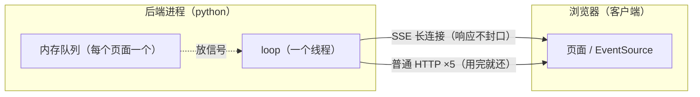

# SSE 面试要点

## 一句话

> **浏览器发一个 HTTP 请求，服务器不结束响应，之后有事就往里写。**
> 方向单向：服务器 → 浏览器。

---

## 1. 为什么不用轮询

| | 轮询 | SSE |
|---|---|---|
| 谁发起 | 浏览器每隔几秒问一次 | 服务器有事才写 |
| 空闲时 | 一直空查 | 零请求 |
| 延迟 | 0～4 秒 | 毫秒级 |
| 数据库 | 每次轮询都查 | 只在真有事时查 |

**轮询是"你去问"，SSE 是"它来说"。**

---

## 2. 三个东西别混

| 东西 | 是什么 |
|---|---|
| **loop** | 后端本来就有的**一个线程**，同时照看很多连接 |
| **SSE 长连接** | 一条不结束的 HTTP 响应（连接，不是线程） |
| **内存队列** | 每个页面一个"信箱"，别的线程往这里放信号 |

比喻：

- 长连接 = 一部一直通着的电话
- queue = 电话旁边的便签盒
- loop = 接电话的人

**SSE 连接建立在 loop 上面，不是 loop 的一部分，也没有"SSE 线程"。**

---

## 2.5 线程分工（谁在跑代码）

**后端进程里只有三类线程：**

```text
python 后端进程
├── loop 线程 × 1  ——————》内部不断跑循环，于是叫循环线程
│     ├── 异步接口（async def）
│     ├── SSE 连接
│     └── WebSocket 连接
│
├── 线程池 × 约40（普通工作线程）
│     └── 同步接口（def）：登录、点赞、评论、下单
│
└── MQ 消费者线程 × 3
      └── 关单、记账、通知
```

**"HTTP 线程"指的就是线程池里借出来的那一条，不是 loop。**

### 一个点赞请求的走向

```text
① 浏览器发 POST /articles/56/like
② loop 线程接住连接、解析 HTTP
③ loop 发现这个接口是 def（同步）
④ 把函数丢给线程池
⑤ 线程池某条线程执行 like：
      写库 → 调 notify() → notify 里调 push_notification()
⑥ push_notification 把 _put 排回 loop 的待办
⑦ loop 执行 _put，往 SSE 的队列放信号
⑧ loop 里的 gen() 取到，写给浏览器
```

**关键：⑤ 在"线程池线程"里；⑦⑧ 在"loop 线程"里。**

### 三种连接分别住哪

| 连接 | 谁在管 |
|---|---|
| 普通 HTTP 请求 | 连接由 loop 接，函数在线程池跑 |
| SSE `/events` | 整条连接都在 loop |
| WebSocket `/ws/chat` | 整条连接都在 loop |

**一句话：**

> **loop 是 1 条线程，负责"接连接 + 跑要等的东西"；普通同步接口被它丢到线程池去执行。notify 在线程池那条线程里跑，所以它只能"预约"loop 去碰队列。**

---

## 3. 图（录视频就照这个讲）



如果预览不支持 mermaid，用下面这张：

```text
        浏览器（客户端）                    后端进程（python）
   ┌──────────────────────┐          ┌───────────────────────────┐
   │                      │◀── SSE ──│                           │
   │   页面 / EventSource │          │        loop（一个线程）     │
   │                      │◀─ HTTP ──│                           │
   │                      │◀─ HTTP ──│   内存通知队列（每个页面一个）│
   │                      │◀─ HTTP ──│       普通工作线程          │
   └──────────────────────┘◀─ HTTP ──└───────────────────────────┘
            同一域名最多 6 条连接（HTTP/1.1）
            SSE 借 1 条不还，剩下 5 条给普通请求
```

loop 是 1 条线程，负责"接连接 + 跑要等的东西"；普通同步接口被它丢到线程池去执行。notify 在线程池那条线程里跑，所以它只能"预约"loop 去碰队列。
---

## 4. 一次点赞的完整流程

```text
① A 点赞
   → 普通 HTTP 请求 POST /articles/56/like

② 后端：写 article_likes
        调 notify()：写 notifications 一行
        调 sse.push_notification(作者 B)

③ push_notification
   → call_soon_threadsafe：让 loop 线程去执行 _put
   （放信号这一段是后端内部活动，不经过长连接）

④ loop 线程执行 _put
   → 翻 _queues，找到 B 的每个页面对应的队列
   → put_nowait({"type": "notification"})
   → 一次事件只放一张，不重复

⑤ /events 里的 gen() 一直在 await 队列
   → 醒了 → yield "data: {...}"
   → 沿 B 的 SSE 长连接写出去

⑥ B 的浏览器 EventSource 收到
   → App.vue 刷新红点
   → 消息页重新拉列表
```

**推送只负责"敲门"，内容永远是前端查库拿的。**

---

## 5. 关键设计（面试可讲）

**① 只推信号，不推内容**

```json
{"type": "notification"}
```

- 推送可能早于事务提交，甚至事务回滚
- 推送可能丢
- 内容和数据库永远以数据库为准

**② 离线跳过，上线补拉**

- 不在线 → 没有队列 → 直接跳过
- 下次打开页面 → 先拉一次未读数/列表 → 再建新连接

**③ 断线重连**

- `EventSource` 浏览器自动重连
- 但断线期间漏掉的推送不会补
- 解决：`es.onopen` 时再拉一次

**④ 心跳**

每 20 秒没消息发 `: ping`，防止代理掐掉空闲连接。

**⑤ 清理**

`finally` 里删除队列，否则内存泄漏。

---

## 6. 代码位置

| 位置 | 作用 |
|---|---|
| `myapp/sse.py` `set_loop()` | 启动时存下事件循环 |
| `myapp/sse.py` `push_notification()` | 给同步代码用的推送入口 |
| `myapp/sse.py` `_put()` | 把信号放进每个队列 |
| `myapp/sse.py` `events()` | `/events` 长连接 |
| `myapp/routers/notifications.py` `notify()` | 写库后调 `push_notification` |
| `myapp/main.py` | `set_loop` + 挂路由 |
| `myapp-frontend/src/App.vue` | `EventSource`，收到就刷新红点 |
| `myapp-frontend/src/components/NotificationsPage.vue` | 监听 `notify-push` 重新拉列表 |

---

## 7. 常见问题

**Q：SSE 和 WebSocket 区别？**

| | SSE | WebSocket |
|---|---|---|
| 方向 | 单向 | 双向 |
| 浏览器 API | `EventSource` | `WebSocket` |
| 断线重连 | 自动 | 自己写 |
| 适合 | 通知、红点、行情 | 聊天、协作 |

**Q：为什么 token 放网址？**

`EventSource` 不能设置自定义请求头，只能 `/events?token=xxx`。

**Q：消息丢了怎么办？**

推送丢了没关系，通知已经在数据库里；前端下次拉取照样能看到。

**Q：多实例怎么办？**

连接表在内存里，多进程找不到对方；要换成 **Redis 发布订阅** 广播。

**Q：为什么一个用户开三个页面会有三个队列？**

每个页面一个连接、一个队列，各自都要收到推送。

**Q：为什么不在 `/events` 里直接查数据库？**

那样就退化成轮询了。推送是"提醒"，查库是"取内容"，两件事分开。

---

## 8. 一句话总结

> **SSE = 一条不结束的 HTTP 响应 + 一个内存信箱 + 一个 loop 线程。**
> 写库之后推一个信号，前端收到自己去查；丢了不补，靠上线时拉一次。
